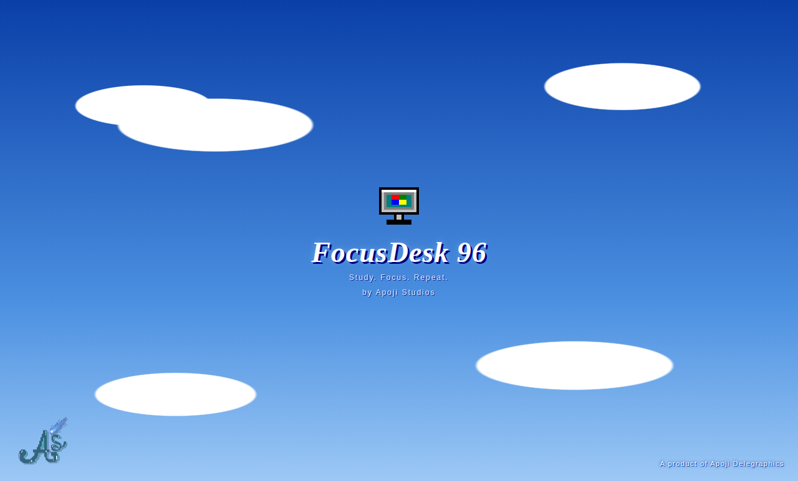
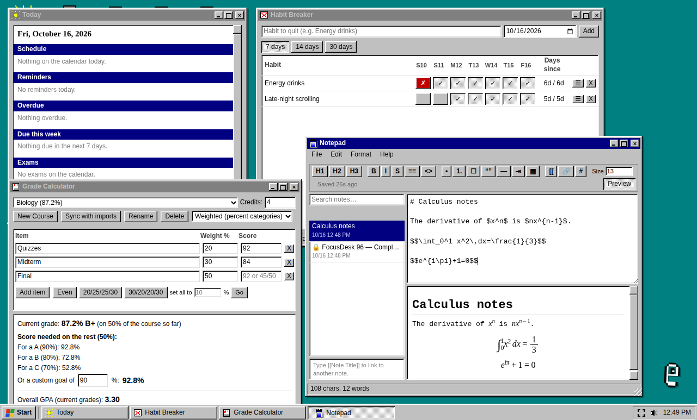

# FocusDesk 96 — Desktop Edition.

The complete FocusDesk 96 study environment, now as a native desktop app
for macOS, Windows, and Linux. Same features. Real files on your computer
instead of browser storage. Portable, backupable, and fully yours.

[](https://github.com/apojidelegraphics/FocusDesk-96/releases)
[](LICENSE)



**When does it update?** See the [update schedule](ROADMAP.md) (also on the [website](https://apojidelegraphics.github.io/FocusDesk-96/roadmap.html)): updates come in small cycles (a Major update, then five Minor updates, the last of which is a Stability update), and urgent fixes ship as Hotfixes.

FocusDesk 96 is a complete study and productivity environment built as a Windows 95-style
desktop: windows, a taskbar, a Start menu, and a little assistant called Clipy. It has no
accounts and no cloud. Everything runs on your computer.

## What's inside



**Study tools**
- 📅 Calendar — Month and Week views, drag to reschedule, click any hour to time-block. Click the taskbar clock for a mini calendar with a dot under every day you have something to do, plus your timers
- 🔗 Calendar Link — Load a `.ics` file from Canvas, Infinite Campus or Apple Calendar; assignments and classes flow into everything else
- 📝 Notepad — Markdown editor with live preview, note linking, task checkboxes, templates, LaTeX math, pasted or dropped images, `#tags` and a course for each note
- 🗂 Folders — Course hubs that gather a course's assignments, notes, flash cards and grade by themselves, smart folders (a tag, a course, a due date), nested folders with colours and icons, pin to Today, archive a semester with final grades, export as a zip of Markdown notes, and share notes and cards with a study group as one file
- 🃏 Flash Cards — Real spaced repetition (SM-2), cloze cards, image-occlusion cards, import from Quizlet
- ⏱ Focus Timer — Pomodoro with background sound and auto-logged stats
- 📚 Grade Calculator — Current grade, exactly what you need on the rest, and a "what if" slider
- 🎓 Class Schedule — Weekly class times, semester start/end
- 📊 Study Stats — 14-day chart, 6-month heatmap, weekly goal, day streak, and your best hour of the day
- 📈 Weekly Review — Full summary of any week
- ✅ Tasks, Reminders, Habits, Countdowns
- 🚫 Habit Breaker — Track something you want to stop: clean days, a slip log, and a note on what triggered it
- 🏆 Achievements — 30 badges
- 📖 Assignment Planner, Formula Sheet, Dictionary
- ⚗️ Periodic Table — All 118 elements, an element card (configuration, melting and boiling points, density, oxidation states), colour views, a temperature slider that melts and boils the elements, a molar mass calculator, a quiz, and flash cards from the elements
- ✍️ Citation Maker — Websites, books, articles, videos, podcasts, lectures, datasets and AI text in APA, MLA, Chicago, Harvard, IEEE and Turabian. Fill in from a DOI or ISBN, in-text citations, BibTeX and RIS import and export, copy with italics, and `[@key]` markers that let a note cite its own sources
- 🔢 Unit Converter, Equation Solver, Math Grapher, Randomizer
- 🖌 Sketch Pad — Pencil, brush, shapes, arrows, eyedropper, select and move, zoom and pan, graph, lined and Cornell paper, undo and redo, insert a sketch into a note, or turn it into image-occlusion flash cards
- 🗑 Recycle Bin, 🔍 Find, 📦 Migrate

**Assistant**
- Clipy — your study companion in the corner
- Works with Claude, OpenRouter, OpenAI, DeepSeek, or Gemini (bring your own key)
- Runs fully offline with M.X.E.S. via Ollama or LM Studio
- If an answer comes back broken (like a bare safety label), Clipy quietly tries again, and every answer has a Regenerate button
- Clipy and Control Panel show when an assistant can't be reached

**Extras**
- 🔎 Command palette — `Ctrl/Cmd+K` searches everything (notes, tasks, cards, assignments, courses, tags) and opens any app or action. `#tag`, `@course` and `>` narrow it down
- 🎮 Games — Solitaire, Sudoku, Tetris, Snake, 2048, Memory, Pong, Minesweeper, Typing, Board Games
- 🎨 12 colour themes + Tritone icon themes
- 🖱 Colourable pixel-art cursors
- 💾 Portable JSON data — back up, sync, or move between machines. Merging a backup can bring over its look too
- 💬 Feedback — report a problem or suggest an idea from Control Panel

## What's new in the desktop version

### New in 1.4.2 (safety net)

- ↩️ **Undo for deleting things.** A small bar offers Undo right after a delete (or press Ctrl/Cmd+Z), and puts the item back where it was. A heads-up appears if you add something you already have.
- 💾 **Better automatic backups** (desktop): today's backup stays up to date while FocusDesk is open, every backup is checked after it is written, and **Back up now** saves one on the spot. If nearly everything is deleted by mistake, the bigger backup is kept beside it.
- 🧯 **A crash log** (desktop): error text only, with your name, folders and keys removed. Nothing is ever sent automatically; **Send details** only opens a draft in your browser for you to read and submit.
- 📋 **Copy backup** (browser) puts your whole backup on the clipboard as text, and a small sign says whether FocusDesk works offline and that your data stays on your device.
- 📊 **The storage numbers add up** (browser): daily snapshots are counted as copies, with a button to delete them. The empty space under the storage bar is gone.
- 🏷️ **Updates can carry more than one tag**, like MAJOR and HOTFIX together.
- 🪟 **Pop-outs** re-measure themselves when they open (BETA, Mac), and Research's **Continue with Clipy** opens Clipy's own pop-out when Research is popped out (BETA).
- The Dock number, Clipy's change-and-complete and the backup-file picker are no longer BETA.

### New in 1.4.1 (fixes and polish)

- 🌠 **A new logo** on the Start button, and a new Mac menu bar icon.
- 🤖 **Clipy can change and complete things you already have** (BETA): ask it to move an event or tick off a task. It always asks first, and Undo puts it back.
- ⚙️ **Start → Settings** jumps straight to the right part of Control Panel (new Storage, Backup and Updates entries too).
- 📊 **A clearer storage bar** (browser) that shows what is using the space, with checked numbers.
- 📁 **Backup folder help** (browser): real error messages, a guide to Chrome's "contains system files" message, and a choose-the-file option (BETA).
- 🍎 **Mac:** an optional red number on the Dock icon (BETA). 🪟 **Windows:** Ask Clipy and Mini timer in the taskbar right-click menu. 🖥️ **Pop-outs** open where you left them, never off screen (BETA), with a Reset button.
- 🏷️ Small **tags** (MINOR, BETA) now sit beside versions and single features.

### New in 1.4 (stability)

- 🔒 **Security fixes** in how notes are shown, a safer graphing calculator, and web lookups that can't reach your own network.
- 🛡️ **Safer with several tabs and windows**: changes merge instead of overwriting each other, and one app having a problem can't stop the others.
- ⚡ **Quicker start-up** (any key skips it), easier-to-read hint text, a **Jump to** row in Control Panel, and counts that read properly.
- ✅ **Automatic safety checks** run in every build.

### Since 1.0

- 🔄 **Silent updates** for Windows and Linux (you choose: automatic, ask first, or just tell me). A Mac still tells you and links to the download.
- 🎵 **Windows Now Playing checks every media session**, so it finds the one that's playing and more covers.
- 🤖 **Clipy has an Undo button** after it adds things, and can make flash cards.
- 🪟 Pop-outs **remember their size and position**, and the command palette can pop out any app.
- 🌐 The website shows a **new-version bar**, and warns when browser storage is nearly full.
- 🤖 **Clipy can add things.** Ask for an event, reminder, task or assignment in plain English; Clipy shows what it wants to add and you press Add.
  On a Mac you can also send what Clipy adds to Apple Calendar (optional).
- 🪟 **Pop-outs are tidier**, and any app can be opened in its own window from **File > Pop Out App** or the tray icon.
- 💾 **The browser's storage bar is accurate** in every browser.
- 📅 **Write to Apple Calendar and Reminders (Mac).** Your events, assignments, reminders and tasks can go into a calendar and a Reminders list
  called FocusDesk, and ticking off a reminder on your iPhone ticks it off here too. Off by default; changes only that calendar and list.
- 🪟 **Pop out an app.** Move Notepad, Flash Cards or most other apps into their own window, for example Notes on one screen and your reading on the other.
- 🍎 **Apple's on-device model for M.X.E.S.** (Mac with Apple Intelligence, macOS 26 or newer).
- 🎵 **Cover lookup for Now Playing** (optional), and a **newest-copy file for the browser version** to load from an iCloud Drive folder (optional).
- 🪟 **Windows fixes (1.2.6).** Full screen works the same from the button, `Alt+Enter`, `F11` and the View menu, and FocusDesk no longer
  starts in full screen. Saving copes with antivirus and cloud-sync tools, and says exactly what went wrong if a save fails. The red
  number on the taskbar icon is now optional, and right-clicking the taskbar icon offers quick actions.
- ⌨️ **Shortcuts you can change.** Control Panel → Desktop lists every global shortcut with Change and Reset buttons, tells you when
  another app already has the keys, and has two new ones to switch on: start or pause the focus timer, and bring FocusDesk to the front.
- 🔄 **Update checking that explains itself.** The desktop app asks GitHub from its own process, with a second source if the first is
  busy, and Control Panel shows when it last checked and what it found.
- 🃏 **Flash card hotkey.** Press `Cmd/Ctrl+Shift+Y` anywhere to turn the text you just copied into a new flash card. The
  quick capture window opens on the Card tab with the front filled in, so you only type the back.
- ▶️ **Now Playing in the clock.** Click the taskbar clock for a player above the calendar: cover, scrub bar, play, pause, next,
  previous, shuffle and repeat. An optional indicator next to the clock shows the song and opens it. The Now Playing pill has
  shuffle and repeat too.
- 🧪 **Full LaTeX, offline.** Math is drawn by [KaTeX](https://katex.org/), bundled inside the app: aligned
  multi-line equations, arrays, boxed and cancelled terms, colours, and chemistry with `\ce{2H2 + O2 -> 2H2O}`.
- 🍎 **Apple Calendar and Reminders (Mac).** In Calendar Link, choose which Apple calendars and Reminders lists
  to follow. They're mirrored into your calendar and Tasks and refreshed each time you sync, or when FocusDesk
  starts. FocusDesk only reads them and never changes them. macOS asks for permission first.
- 🔗 **Calendar feed sync.** Paste your Canvas (or Google, Apple, school) calendar feed link once. FocusDesk fetches it when it
  starts, adds new assignments and events, and updates changed due dates. The link is kept in `keys.json`,
  never in your backups.
- 🎵 **Now Playing.** A small always-on-top pill with the song, its album cover, a scrub bar, and play, pause,
  next and previous. It works with Spotify and Apple Music on Mac, any media player on Linux (needs `playerctl`),
  and the system media controls on Windows. Drag it anywhere; it remembers where you left it.
- ⏱ **Mini timer.** The focus timer as a small draggable pill that stays on top of your other windows.
- 🐿 **Ask Clipy pop-out.** Clipy gets his own always-on-top window in the bottom-right corner of your screen,
  with the same conversation as the one in the app.
- 📥 **Menu bar and tray.** FocusDesk can keep running in your menu bar or system tray. Its menu lists what's due:
  cards, tasks and assignments, with an option to include or leave out overdue ones. It also starts a focus
  session, opens the mini timer and Now Playing, and adds a quick task.
- ⚡ **Quick capture.** Press `Cmd/Ctrl+Shift+Space` from any app to add a task, note, reminder, event or
  question for Clipy. It understands "tomorrow at 5pm" and "in 30 min".
- 🔔 **Native notifications** for reminders and when a focus session ends.
- 📁 **Choose where backups go.** Pick any folder (Dropbox, iCloud Drive, an external drive) and how many days to keep
  (7, 14, 30, or all). **File → Save Backup Now** makes one on demand.
- 🪟 **Windows touches.** A slim title bar with a `⋯` menu, a taskbar badge with what's due, and open-at-login with
  an option to start hidden.
- ⬆️ **Update checker.** FocusDesk tells you when a new version is out and links to the download. Silent
  auto-update isn't included yet.
- 📁 **Real files on your computer.** Your data lives in a plain, readable
  `data.json` in your OS's standard user-data folder. Back it up, sync it
  with Dropbox, or open it in a text editor.
- 🖥 **Native menus.** Standard Edit, View, File and Help menus on every platform.
- 💾 **Native file dialogs.** Save backups, import `.ics` calendars, and
  export migration files through your OS's real save/open dialogs.
- 🔄 **Automatic daily backups.** Rolling snapshots, written straight to disk,
  no more relying on browser storage. Today's backup is kept up to date, and each one is checked after it is written.
- 🪟 **Window state persists.** FocusDesk remembers its size and position.
- 📦 **Full session restore.** Every window you had open comes back exactly
  where you left it, even after a full quit and relaunch.

## Download

Grab the installer for your platform from the
[latest release](https://github.com/apojidelegraphics/FocusDesk-96/releases/latest):

- **macOS** — `.dmg` (Apple Silicon `arm64` and Intel `x64`)
- **Windows** — `.exe`
- **Linux** — `.AppImage`
- **Browser (Chrome, Edge, Firefox)**: `FocusDesk-96-Browser-*.zip`. This is the **browser version** saved to your computer: unzip it and open `index.html`. It is not the desktop app, and it keeps data in your browser rather than in files, so use Control Panel → Save backup file regularly.
- **Try it online**: the browser version also runs as a website at <https://apojidelegraphics.github.io/FocusDesk-96/>, and you can install it as an app from Chrome or Edge. It keeps working offline after your first visit.

## First launch

These builds are unsigned. That's normal for indie software and doesn't mean anything is wrong. Your computer just can't check who made the app.

Stuck, or have a question like "where is my data?" or "how do I move to a new computer?" See the **[FAQ](FAQ.md)**.

**macOS**

1. Open the `.dmg` and drag FocusDesk 96 into **Applications**.
2. Open **Terminal** and run these two commands:

```sh
   codesign --force --deep --sign - "/Applications/FocusDesk 96.app"
   xattr -cr "/Applications/FocusDesk 96.app"
```

3. Open FocusDesk 96 normally.

You need to do this again after installing each update. If your Mac says the app is "damaged and can't be opened", this is the fix. The app isn't actually damaged, and macOS just shows that wording for unsigned downloads. Choose the Apple Silicon (`arm64`) file for an M1 or newer Mac, and the `x64` file for an Intel Mac.

**Windows**

If SmartScreen appears, click **More info**, then **Run anyway**.

**Linux**

Make the AppImage executable, then run it:

```sh
chmod +x FocusDesk-96-*.AppImage
./FocusDesk-96-*.AppImage
```

If it doesn't start, run it from a terminal once to see the message. On newer Ubuntu releases it may ask you to install `libfuse2`. For Now Playing on Linux, install `playerctl`.

## Your data

Your data lives in:

- **macOS** — `~/Library/Application Support/FocusDesk 96/`
- **Windows** — `%APPDATA%\FocusDesk 96\`
- **Linux** — `~/.config/FocusDesk 96/`

Back that folder up and you've backed up everything.

Inside it:

| File / folder | What it is |
| --- | --- |
| `data.json` | All your FocusDesk data, pretty-printed and human-readable |
| `wall.json` | Your desktop wallpaper (kept separate because it can be large) |
| `settings.json` | Small app settings, such as custom note templates |
| `desktop.json` | Desktop options: notifications, hotkey, tray, open at login, backup folder |
| `keys.json` | Your AI assistant API keys and your calendar feed link (see the note below) |
| `backups/` | Automatic daily backups, one per day (newest 7 kept by default; you can choose another folder and how many to keep) |
| `migrate/` | A copy of every file the Migrate app exports |
| `window-state.json` | Window size and position |
| `focusdesk.log` | A small log of problems (like a failed save), kept on your computer |
| `mini-timer.json`, `now-playing.json` | Where you left the mini timer and Now Playing pills |

**Back up or move to another computer:** quit FocusDesk, copy the folder (or just `data.json`),
and put it in the same place on the other machine. Syncing the folder with Dropbox or similar
works too; just don't run FocusDesk on two computers at the same moment.

**Restore a backup:** quit FocusDesk, then copy a file from `backups/` over `data.json`. Or use
**Control Panel → Restore from file…** inside the app and pick the backup. **Merge from file…** adds
what's in a backup to what you have, and can bring over its theme, icons, cursors and wallpaper too.

**Open the folder:** use **File → Open Backups Folder** in the app.

All writes are atomic (written to a temporary file, then swapped in), so a crash or power cut
can't leave you with a half-written file. If a data file is ever unreadable, FocusDesk sets it
aside as `*.corrupt-<timestamp>`, starts fresh, and tells you.

> **API keys and your calendar feed link are stored unencrypted in `keys.json` in your user data folder. Keep that file private.**
> It's a separate file so you can share `data.json` without sharing your keys. Backup files made
> from inside the app never include them.

## What it connects to

FocusDesk has no servers of its own and sends nothing to us. It only reaches out when you use a feature that needs it:

- your **AI assistant**, if you add a key (or your own computer, if you use Ollama or LM Studio)
- **Research** lookups (Wikipedia, Crossref, Open Library, Datamuse, DuckDuckGo)
- the **Citation Maker**, when you press Fill in with a DOI, an ISBN or (desktop app) a web link
- the **update check**, which asks GitHub for the latest version number (and, if GitHub is busy, a small file on the FocusDesk website)
- your **calendar feed link**, if you save one
- **album covers** in Now Playing, from the music service's image server
- **Feedback**, which opens a pre-filled GitHub page in your browser (nothing is sent until you press Submit)

Apple Calendar, Reminders and Now Playing are read on your own computer and stay there.

## Development

You need [Node.js](https://nodejs.org/) 20 or newer.

```sh
git clone git@github.com:apojidelegraphics/FocusDesk-96.git
cd FocusDesk-96
npm install
npm start
```

`npm install` also copies KaTeX into `vendor/katex/` (that folder isn't committed). `npm start`
launches the app with your real user data folder. To develop against a throwaway
copy instead, set a different config location first, for example
`XDG_CONFIG_HOME=/tmp/fd-dev npm start` on Linux.

How it fits together:

- `focusdesk.js`, `focusdesk.css`, `index.html`: the app. It is still plain vanilla JavaScript
  and still runs on its own in a browser (browser version 2.7.x).
- `main.js`: Electron main process. Files, backups, dialogs, menus, tray, window state, and the small pill windows.
- `preload.js`, `aux-preload.js`: the small `window.focusdesk` API (and a smaller one for the pills). The page never touches `fs` itself.
- `focusdesk-desk.js`: desktop shim loaded before `focusdesk.js`. It swaps `localStorage` for
  files and browser downloads and file pickers for native dialogs, and loads KaTeX.
- `nowplaying.js`: reads what's playing on this computer. `apple.js` and `helper/macos/`: the read-only
  Apple Calendar and Reminders helper (Swift).
- `capture.html`, `timer-mini.html`, `nowplaying.html`: the quick-capture window and the two pills.
- `pwa/`: the manifest, icons and offline helper for the website version.

## Building

Installers are built with [electron-builder](https://www.electron.build/). Build on the OS you
are targeting:

```sh
npm run build:mac     # .dmg   (run on macOS)
npm run build:win     # .exe   (run on Windows)
npm run build:linux   # .AppImage (run on Linux)
```

Output goes to `dist/`. Before each build the app icon is generated from `apojilogo.js`
(`scripts/build-icon.js`) and KaTeX is copied in (`scripts/vendor-katex.js`). The Mac build also compiles the
Swift helper into one program for both Apple Silicon and Intel (`scripts/build-mac-helper.js`); if that step
fails, a stand-in is packaged and the app just says Apple Calendar isn't available in that build.

**Releasing:** bump `version` in `package.json`, commit, then push a matching tag:

```sh
git tag v1.2.3
git push origin v1.2.3
```

The GitHub Actions workflow builds all three installers and the browser zip, and attaches them to a **draft**
release. Review it on the Releases page and publish when you're happy.

**The website:** a second workflow (`.github/workflows/pages.yml`) publishes the browser version to GitHub Pages
whenever the app files change on `main`. One-time setup: Settings → Pages → Source → **GitHub Actions**.

## About Apoji

FocusDesk 96 is a product of **Apoji Delegraphics**, developed in collaboration
with **Apoji Studios**.

**Apoji Studios** is the creative design arm: the people behind every pixel,
every theme, every bit of polish. The Windows 95 aesthetic, the Tritone icon
system, Clipy, the sound design, and the whole feel of the desktop come from
here. If it looks and feels like something, the Studio made it.

**Apoji Delegraphics** is the engineering and security side: software
development, cybersecurity, and firewall protection solutions, plus AI work.
The data model, the sanitization layer, the offline-first architecture, the
local-first, no-account design, and everything that has to *hold up under
pressure* comes from here. If it works, and keeps working, Delegraphics built it.

FocusDesk 96 is the first product to come from both sides at once.

---

## From Lucas Roland, CEO

> I'm Lucas Roland, and I run two companies. Apoji Studios makes things that
> look and feel good. Apoji Delegraphics makes sure they work, stay secure,
> and hold up when it matters.
>
> FocusDesk 96 started as a personal frustration. Every study app I tried
> wanted my data on their server. Every planner wanted a subscription. Every
> timer wanted to send me push notifications at 7 AM. So we built the
> opposite: a complete study environment that lives entirely on your device,
> that doesn't have an account system because it doesn't need one, and that
> treats your attention as the scarce resource it actually is.
>
> It's the first thing the Studio and Delegraphics have built together, and
> it's the template for everything we're going to make next. Design and
> engineering in the same room, from day one, on products we'd actually use
> ourselves.
>
> Whether you're a student cramming for a chem midterm or someone just
> trying to build better habits, I hope FocusDesk gives you a real place to
> work. Something that feels like *yours*.
>
> — Lucas

---

## License

MIT © 2026 Apoji Delegraphics and Apoji Studios. See [LICENSE](LICENSE).

See [TERMS.md](TERMS.md) for the full terms of use, privacy notes, and brand rules.

Third-party software is listed in [THIRD_PARTY_NOTICES.md](THIRD_PARTY_NOTICES.md).

Found a bug or have an idea? Use **Control Panel → Feedback** in the app, or [open an issue](https://github.com/apojidelegraphics/FocusDesk-96/issues/new/choose). Common questions are answered in the [FAQ](FAQ.md).

## Credits

A product of **Apoji Delegraphics**, designed by **Apoji Studios**.

Full browser-version history lives in the app's own Notepad under
"FocusDesk 96 — Complete Guide".

---

*FocusDesk 96 is a product of Apoji Delegraphics, designed by Apoji Studios.*

*© 2026 Apoji Delegraphics and Apoji Studios. Released under the MIT License.*

*Lucas Roland, CEO*
